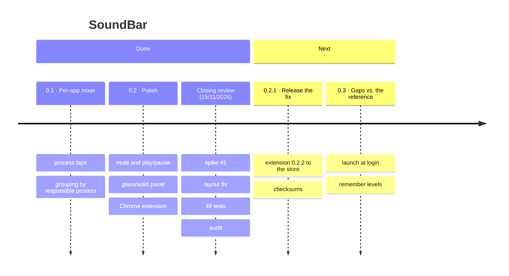

# SoundBar — handoff

**Status:** app and extension work and are tested; v0.2.0 (the current release) still has the output-device-with-inputs bug fixed on `main`. · **Last update:** 15/11/2026
**Language:** Swift (app, the right fit for Core Audio + SwiftUI menu bar) and vanilla JS (Chrome extension, required) · **Shape:** simple, no layers
**Run:** `./scripts/build-app.sh && open dist/SoundBar.app` · **Tests:** `swift test` and `node --test test/extension/popup.test.js` · **Deploy:** none (desktop app; releases are DMGs on GitHub)

## Roadmap

| Stage | What's in it | Status | Criteria (SPEC) |
|---|---|---|---|
| 0.1–0.2 | mixer, mute, play/pause, panel styles, extension | ✅ | CA-1…CA-13 |
| Closing review | spec, tests, worst-case run, audit, ADRs, docs | ✅ | all |
| 0.2.1 | release PR #3 + this review, extension 0.2.2 | ⏳ | CA-2, CA-3 |
| 0.3 | parity gaps (see `docs/SPEC.md` §7) | ⏳ | — |

## What was done (latest first)
- 15/11 · Closing review: `docs/SPEC.md` with a parity table, 31 new Swift tests and 12 Node tests (worst case), security review (`docs/AUDITORIA.md`), six ADRs, SECURITY.md corrected and given a tested-guarantees table. Extension 0.2.2: icons from the local cache (no network), `tabs` permission removed, stricter CSP. App version bumped to 0.2.1.
- 15/11 · Spike #1 closed: Apple Events work, crash cleanup works, buffer layout failed → #2, fixed in PR #3.
- 19/08 · FaceTime's call daemons grouped as FaceTime.
- 18/08 · v0.2.0: panel styles, icon, INSTALL.md.

## Next
1. Release v0.2.1 (it ships PR #3) — #10. After merging the closing PR:
   `git tag -a v0.2.1 -m "v0.2.1" && git push origin v0.2.1`, then build the universal DMG (see `docs/interno/DISENO.md` §7) and `gh release create v0.2.1 --generate-notes` with the DMG and its SHA-256.
2. Load extension 0.2.2 unpacked in Chrome and check that titles and icons still show, then send it to the Web Store — #11.
3. Parity gaps: launch at login #12, remembering levels #13, sleep/wake and unplugging #14, permission-denied hint #15.

## Decisions I made (for veto)
- **Extension icons come from the browser's local favicon cache** (`favicon` permission) instead of the page's own icon URL, and the `tabs` permission was removed. You chose "fix now"; it's not tested in a real browser. `extension/manifest.json`, `popup.js` (`render`).
- **A corrupt stored tab volume shows as 100 %** (anything that isn't a finite number), and values are clamped to [0, 1]. `popup.js` (`getState`).
- **Muting a tab that closed while the popup was open does nothing** instead of throwing. `popup.js` (mute handler).
- **`setVolume(.nan)` stays as silence (0)**, documented by a test rather than changed. `ModeloTests.volumenNaNQuedaEnCero`.
- **The public audit doesn't describe H1**; details live in the gitignored `docs/interno/`.
- **App version 0.2.1, extension 0.2.2** (patch: fixes only).

## To decide
- `README.privado.md` was absorbed into `docs/interno/DISENO.md`. Delete the original?
- `CONTRIBUTING.md` and `CODE_OF_CONDUCT.md`: the README says "Issues and PRs welcome", but there are no outside contributors yet — #17.
- Move the clone out of iCloud Drive: on 15/11 iCloud had duplicated source files and git refs (`TapMixer 2.swift`, `.git/refs/heads/main 2`), which broke the build and `git log --all`.
- Branch protection on `main` (audit I2, accepted for now) — #17.

## Pending and known debts
- Open audit items: the mic streams in the aggregate #5 (M1), the MAIN world #6 (L1), injection into tabs that navigated elsewhere #7 (L2), distribution checksums and a DMG script #8 (L3), the observer never disconnects #9 (I1).
- Stereo always goes to channels 1–2, not the device's preferred pair — #16.
- The app doesn't detect a denied audio permission (the slider mutes instead of lowering) — #15.
- Play/pause icon lag (#4).
- **Observability:** by design there's no telemetry or crash reporting (zero network). The only signal is GitHub issues, and local logs (`log stream --predicate 'subsystem == "com.malenitaa.soundbar"'`). Nothing to declare in SECURITY.md because nothing is sent.
- **Deploy:** doesn't apply (desktop app and browser extension).

## Where everything is
| What | Where |
|---|---|
| Spec and criteria | `docs/SPEC.md` |
| Decisions | `docs/adr/` (`INDICE.md`) |
| Internal design | `docs/interno/DISENO.md` (gitignored) |
| Audit | `docs/AUDITORIA.md` |
| For others | `README.md`, `SECURITY.md`, `INSTALL.md`, `extension/PRIVACY.md` |
